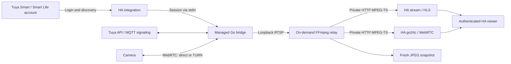

# How it works

The user configures an account in Home Assistant. The integration discovers
camera devices and manages a Go bridge; viewers use native HA camera entities.

## Media and processes

The bridge handles the Tuya mobile protocol and presents RTSP on automatically
allocated loopback ports. A relay starts when media is requested. H.264 video
is copied; HEVC is decoded and encoded to H.264 at 720p / 15 fps for playback.
Receive audio is converted to AAC for the HTTP relay and Opus through the native
HA WebRTC provider. The tested HEVC camera supplies 16-bit PCM audio; the bridge
converts its sample byte order and preserves RTP sampling timestamps.

HA's built-in `stream`, FFmpeg integration and go2rtc provider serve the frontend.
No separate ONVIF service, MediaMTX installation or user-managed RTSP port is
required. This is a native custom integration with supervised subprocesses; the
Go executable is installed automatically for Linux amd64/AArch64.

The managed integration does not launch Docker or require a separate container.
On HA OS, its Go/FFmpeg processes run inside the existing Home Assistant Core
container. No standalone add-on or Docker image is shipped.

## Lifecycle

Each account entry owns its bridge and camera relays. Shutdown, unload and removal
stop owned processes. Crash recovery restarts the bridge with bounded retry
delays; an expired session requests UI reauthentication. Camera availability and
last-video activity help distinguish a connected process from fresh media.
Snapshots request current video rather than returning an indefinitely cached JPEG.

## Network and trust

The integration also owns [LAN DP connections](local-controls.md)
for camera settings and telemetry. The local key and schema are provisioned once
through account setup and persisted privately by HA. Runtime reads, commands,
reconnection and event handling never fall back to cloud APIs. These connections
use media activity windows on battery cameras and close during standby.
For protocol-3.3 cameras with provisioned media credentials, Go shares one
signaling/DP socket with the local AES/KCP media transport. Python accesses it
through private loopback IPC, without opening a second camera socket. This path
accepts spontaneous scalar reports and command confirmations, without periodic
DP queries or refreshes, which interrupted media on the tested firmware.
Other cameras retain the TinyTuya control path.
Settings and telemetry entities are discovered from valid camera observations,
not schema declarations alone. HA restores timestamped last observations on
battery models without treating them as fresh command confirmations. Old
unconfirmed entities are disabled without deleting their registry identities.

Account provisioning requires internet access. The development bridge attempts
local command-32 signaling first for the verified 3.3 profile. A sleeping camera
still needs cloud wake (MQTT, with WebRTC wake as fallback). Other profiles keep
the cloud WebRTC path and may use TURN. This project has not established fully
offline operation; see [evidence and limits](offline-operation.md).

The password is transient; HA stores session data in its config entry. Session
material reaches the bridge through stdin. Release executables are versioned,
SHA-256 verified and installed atomically. Managed listeners bind to loopback;
relay paths are random. HA authenticates access to its camera frontend.

When talkback is enabled, its UDP RTP/RTCP return channel follows the RTSP
listener's bind address, including after stream reconnection. Managed mode uses
`127.0.0.1`, so LAN hosts cannot inject audio through that channel.

The subprocesses share the HA container's permissions. Loopback listeners are
not isolation from other processes in that container. Treat HA backups as
sensitive and see [SECURITY.md](../SECURITY.md).
